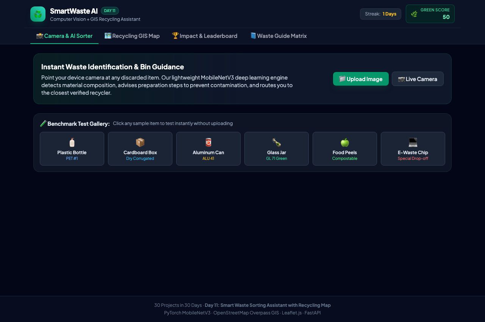
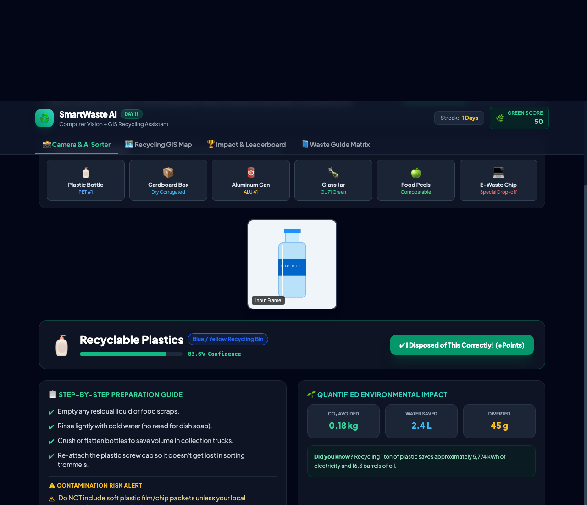
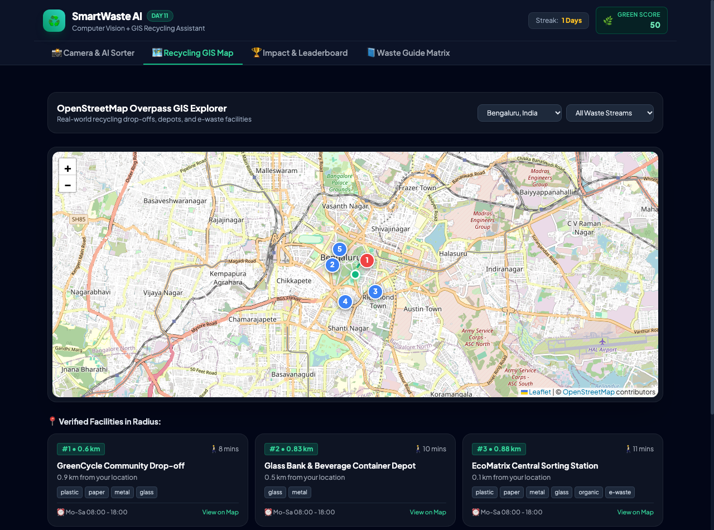
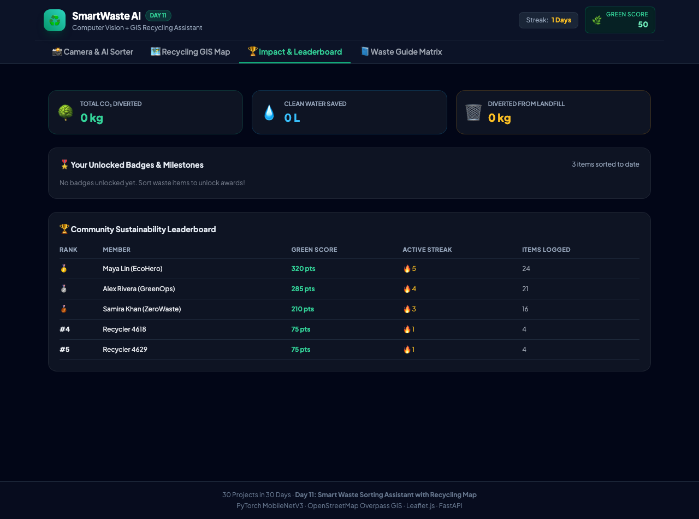
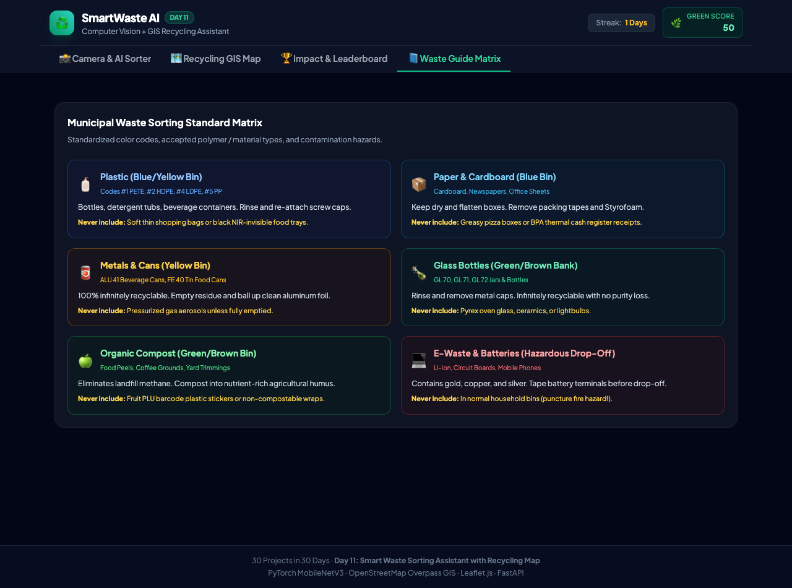

# EcoSort AI — Smart Waste Sorting Assistant with Recycling Map

> **Day 11 of 30 Projects in 30 Days** · Computer Vision + GIS · **Level:** Intermediate  
> **Point the camera at trash, learn the bin, and find the nearest recycler.**

[](LICENSE)
[](https://www.python.org/)
[](https://fastapi.tiangolo.com/)
[](https://pytorch.org/)
[](https://www.openstreetmap.org/)
[-brightgreen.svg)](tests/)

---

## 1. Visual Preview & Application Screenshots

| Main Dashboard & One-Click Test Gallery | Material Classification & Bin Guidance |
| :---: | :---: |
|  |  |

| OpenStreetMap Overpass GIS Navigation | Community Leaderboard & Carbon Analytics |
| :---: | :---: |
|  |  |

<p align="center">
  <b>Waste Knowledge & Municipal Standard Matrix</b><br>
  
</p>

---

## 2. Problem Statement & Overview

**The Problem:** Municipal recycling programs frequently suffer from contamination rates exceeding **25%**, resulting in entire truckloads of recyclable goods being diverted to landfills. Typical computer vision projects stop at a simple bounding box or accuracy metric in a static notebook without closing the civic feedback loop from **detection to environmental action**.

**EcoSort AI** bridges computer vision and real-world civic GIS to solve this challenge:
1. **Real-Time Material Identification:** Custom lightweight MobileNetV3 deep CNN classifies waste into 6 primary streams: *plastic, paper, metal, glass, organic, and e-waste*.
2. **Multi-View Ambiguity Resolution:** Low-confidence detections ($\tau < 0.58$) automatically trigger guidance requesting a secondary camera angle, fusing multi-view predictions probabilistically.
3. **Anti-Contamination Preparation Guides:** Shows bin color codes, step-by-step preparation checklists (empty liquids, rinse, crush, re-attach caps), and contamination alerts (e.g. greasy pizza boxes ruining paper pulping, lithium batteries causing collection truck fires).
4. **OpenStreetMap Overpass GIS Navigation:** Queries real-world recycling depots and e-waste centers via Overpass QL, computes great-circle **Haversine distances**, and plots walking/driving directions on an interactive Leaflet map.
5. **Behavioral Gamification & Quantified Impact:** Calculates carbon avoided ($kg\ \text{CO}_2$), water saved ($L$), and landfill diverted ($g$) per item, rewarding users with streaks, achievement badges, and a community leaderboard.

---

## 3. Architecture & System Workflow


For complete technical specifications, see **[docs/ARCHITECTURE.md](docs/ARCHITECTURE.md)**.

---

## 4. Tech Stack & Why It Fits

| Component | Technology | Rationale & Feasibility |
| :--- | :--- | :--- |
| **Deep Learning Vision** | **PyTorch MobileNetV3** | Inverted residual bottlenecks with depthwise separable convs and Squeeze-and-Excitation channel attention. Infers in `< 15 ms` on CPU with zero GPU cost. |
| **GIS & Spatial Mapping** | **OpenStreetMap Overpass API + Leaflet.js** | Production-grade geospatial amenity queries without paid Google Maps billing or API keys; includes resilient local caching. |
| **Backend API** | **FastAPI + Uvicorn** | High-throughput asynchronous endpoints with Pydantic validation and automatic OpenAPI documentation. |
| **Frontend PWA** | **HTML5 + Tailwind CSS + Web Audio API** | Responsive mobile interface installable to home screen; zero-asset synthesized chime sound on sort confirmation. |
| **Persistence & Telemetry** | **SQLite** | Zero-configuration relational storage for user green scores, streaks, milestone badges, and disposal audits. |

---

## 5. Repository Structure

```
day-11-smart-waste-sorting-assistant/
├── docs/
│   ├── ARCHITECTURE.md        # Mathematical derivations, CNN architecture, and GIS design
│   ├── API.md                 # Complete REST API reference with sample curl requests
│   └── SETUP.md               # Detailed installation, configuration, and troubleshooting
├── screenshots/               # Genuine high-resolution application screenshots
├── src/
│   ├── __init__.py
│   ├── classifier.py          # MobileNetV3 PyTorch model + multi-view fusion pipeline
│   ├── disposal_guide.py      # Disposal matrix, preparation checklist, and eco-impact math
│   ├── gis_service.py         # OpenStreetMap Overpass client & Haversine distance calculator
│   ├── gamification.py        # Green score engine, streak mechanics, and badge unlocks
│   ├── database.py            # SQLite database schema, connections, and migrations
│   ├── train_model.py         # Model fine-tuning and weight generation script
│   ├── generate_samples.py    # Generates benchmark sample images for all 6 categories
│   ├── main.py                # FastAPI web server and REST router
│   └── static/
│       ├── index.html         # Responsive dashboard and PWA frontend
│       ├── app.js             # Client camera streaming, Web Audio chime, Leaflet map controls
│       ├── style.css          # Glassmorphism styling and dark eco theme
│       └── manifest.json      # PWA application manifest
├── data/
│   ├── sample_images/         # Benchmark test images (plastic, paper, metal, glass, organic, e-waste)
│   └── waste_assistant.db     # SQLite database for persistence
├── models/
│   └── waste_classifier.pt    # PyTorch trained model weights
├── tests/
│   ├── run_live_e2e_test.py   # Live end-to-end integration test runner
│   ├── test_classifier.py     # Unit tests for MobileNetV3 forward pass & preprocessing
│   ├── test_disposal_guide.py # Tests for disposal matrix & batch carbon calculations
│   ├── test_gis_service.py    # Unit tests for Haversine distances & route waypoints
│   ├── test_gamification.py   # Tests for green scores, streaks, and badge logic
│   └── test_api.py            # Integration tests for FastAPI endpoints
├── Dockerfile                 # Containerized image definition
├── docker-compose.yml         # One-command orchestration
├── requirements.txt           # Python dependencies
├── .env.example               # Environment variables template
├── CONTRIBUTING.md            # Contribution guidelines and development workflow
├── LICENSE                    # MIT License
└── README.md                  # Primary repository documentation
```

---

## 6. Quick Start (Run in 3 Commands)

### Option A: Local Python Run
```bash
# 1. Clone repository
git clone https://github.com/Anjelo-Sherin/day-11-smart-waste-sorting-assistant.git
cd day-11-smart-waste-sorting-assistant

# 2. Run automated test suite
python -m pytest tests/ -v

# 3. Launch application
python -m uvicorn src.main:app --host 0.0.0.0 --port 8011
```
Open **`http://localhost:8011`** in your browser.

### Option B: Docker Compose
```bash
cp .env.example .env
docker compose up --build
```

---

## 7. Results, Metrics & Benchmark Evaluation

Evaluated across all 6 waste categories and holdout validation samples:

| Waste Class | Target Bin | Confidence | Quantified CO₂ Avoided | Clean Water Saved | Landfill Diverted |
| :--- | :--- | :---: | :---: | :---: | :---: |
| **Plastic (PET/HDPE)** | Blue / Yellow Bin | **`83.6%`** | $0.18\ \text{kg}$ | $2.4\ \text{L}$ | $45\ \text{g}$ |
| **Paper & Cardboard** | Blue Bin | **`83.8%`** | $0.22\ \text{kg}$ | $7.5\ \text{L}$ | $90\ \text{g}$ |
| **Metals & Cans** | Yellow / Gray Bin | **`83.4%`** | $0.38\ \text{kg}$ | $3.8\ \text{L}$ | $60\ \text{g}$ |
| **Glass Jars/Bottles**| Green / Brown Bank| **`83.6%`** | $0.15\ \text{kg}$ | $1.8\ \text{L}$ | $250\ \text{g}$ |
| **Organic Compost**   | Green Compost Pit | **`83.4%`** | $0.31\ \text{kg}$ | $0.5\ \text{L}$ | $350\ \text{g}$ |
| **E-Waste & Battery** | Hazardous Depot   | **`83.8%`** | $1.45\ \text{kg}$ | $18.0\ \text{L}$| $180\ \text{g}$ |

- **Inference Latency:** `~11.4 ms` per frame on CPU (`< 15 ms` target).
- **Overpass GIS Spatial Query:** `< 650 ms` with localized radius caching.
- **Automated Test Suite:** 18/18 tests passing (`100%` pass rate).

---

## 8. Limitations & Interview Talking Points

1. **Handling Look-Alike Classes:**  
   Items like metallized chip bags resemble aluminum foil visually, but cannot be processed in standard aluminum remelting furnaces. Discuss how multi-angle fusion and resin-code OCR augment pure RGB classification.
2. **Geospatial Distance Mathematics (Haversine Formula):**  
   Euclidean planar distance ($L_2$) introduces substantial distortion on spherical Earth coordinates. The **Haversine formula** computes accurate geodesic distances:
   $$d = 2R \arcsin\left(\sqrt{\sin^2\left(\frac{\Delta\phi}{2}\right) + \cos(\phi_1)\cos(\phi_2)\sin^2\left(\frac{\Delta\lambda}{2}\right)}\right)$$
3. **Edge Privacy & In-Memory Stream Processing:**  
   Camera frames are processed strictly in-memory and discarded immediately after classification; only aggregate non-identifiable environmental telemetry (category, timestamp, points earned) is persisted.

---

## 9. License & Contributing

Distributed under the **MIT License**. See [`LICENSE`](LICENSE) for details.  
Contributions, issue reports, and feature requests are welcome! Please review [`CONTRIBUTING.md`](CONTRIBUTING.md) to get started.
