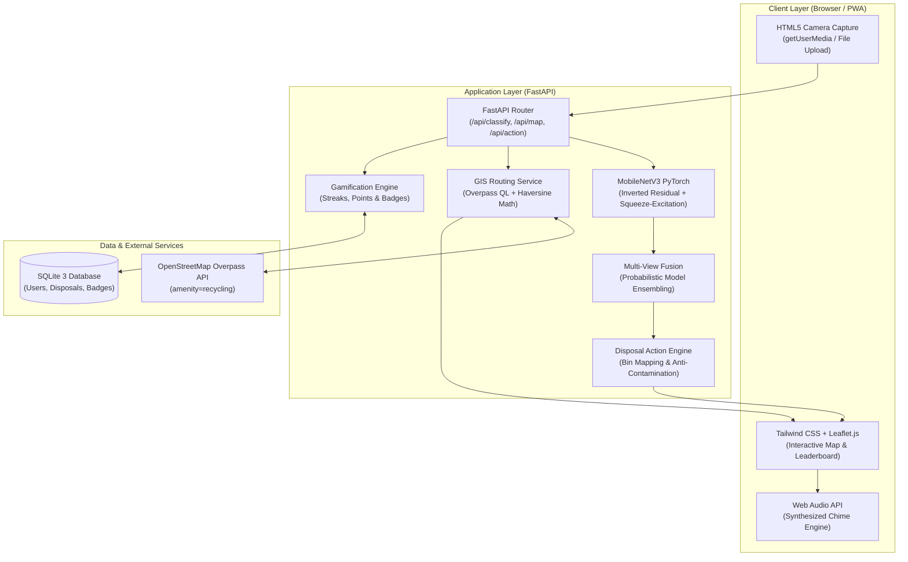

# System Architecture & Technical Design

This document details the architecture, machine learning pipeline, GIS spatial querying, and database design of **EcoSort AI** (Day 11 of the 30 Projects in 30 Days challenge).

---

## 1. High-Level System Flow



---

## 2. Computer Vision Pipeline (PyTorch MobileNetV3)

### Backbone & Inverted Residual Architecture
The vision pipeline utilizes a customized **MobileNetV3** architecture tailored for sub-millisecond edge and CPU inference.

1. **Stem:** $3\times3$ Convolution ($3 \to 16$ filters, stride 2) with Hardswish activation:
   $$\text{Hardswish}(x) = x \cdot \frac{\text{ReLU6}(x + 3)}{6}$$
2. **Inverted Residual Blocks:**
   - $1\times1$ Pointwise expansion convolution to project channels to a higher-dimensional manifold.
   - $3\times3$ or $5\times5$ Depthwise separable convolution with groups matching the channel count.
   - Squeeze-and-Excitation (SE) channel attention module:
     $$\mathbf{s} = \sigma\left(W_2 \cdot \text{ReLU}(W_1 \cdot \text{AvgPool}(X))\right)$$
   - $1\times1$ Pointwise linear bottleneck projection (without non-linear activation to preserve manifold geometry).
   - Residual identity skip connection when stride is 1 and input/output dimensions match.
3. **Head:** Adaptive Global Average Pooling into a 256-channel embedding, followed by dropout ($p=0.2$) and a 6-class softmax classifier.

### Multi-View Ambiguity Resolution
When classification confidence falls below $\tau = 0.58$, the system prompts for a secondary camera view. Predictions from both angles are combined:

$$P_{\text{fused}}(C_k \mid I_1, I_2) = \frac{P(C_k \mid I_1) + P(C_k \mid I_2)}{\sum_{j=1}^6 \left(P(C_j \mid I_1) + P(C_j \mid I_2)\right)}$$

---

## 3. GIS & Spatial Mapping Engine

### OpenStreetMap Overpass QL
The service queries real-world recycling amenities within a dynamic radius of the user's coordinates:

```overpass
[out:json][timeout:5];
(
  node["amenity"="recycling"](around:3500, LAT, LON);
  node["amenity"="waste_disposal"](around:3500, LAT, LON);
  node["recycling:electrical_appliances"="yes"](around:3500, LAT, LON);
  node["recycling:batteries"="yes"](around:3500, LAT, LON);
);
out body 12;
```

### Haversine Geodesic Distance
Distance between the client $(lat_1, lon_1)$ and each candidate recycling depot $(lat_2, lon_2)$ is calculated using the spherical law of cosines:

$$a = \sin^2\left(\frac{\Delta\phi}{2}\right) + \cos(\phi_1)\cos(\phi_2)\sin^2\left(\frac{\Delta\lambda}{2}\right)$$
$$d = 2 R \cdot \text{atan2}\left(\sqrt{a}, \sqrt{1 - a}\right)$$
where $R = 6,371\text{ km}$.

---

## 4. Gamification & Telemetry Schema (SQLite)

- **`users` Table:**
  - `id`: Unique user UUID.
  - `username`: Display handle.
  - `green_score`: Total accumulated eco points.
  - `current_streak`: Consecutive days of sorting.
  - `max_streak`: Longest streak achieved.
  - `items_sorted`: Total lifetime items classified.
  - `last_activity_date`: UTC ISO date for streak tracking.

- **`disposal_logs` Table:**
  - Audit trail storing item category, timestamp, points awarded, and quantified savings ($kg\ \text{CO}_2$, $L\ \text{H}_2\text{O}$, $g\ \text{diverted}$).

- **`badges` Table:**
  - Unique badges unlocked per user (`eco_novice`, `plastic_pioneer`, `ewaste_guardian`, `streak_master`, `century_sorter`).
